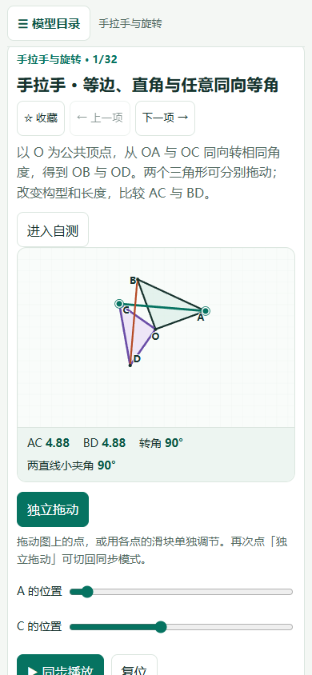

# 几何有迹 · JiHeYouJi

拖动点和射线，观察几何量怎样变化，再用题目检验自己的推导。几何有迹是一款面向初中数学与物理的离线互动练习工具。

[下载公开体验版](https://github.com/zhetao068-lgtm/jihe-youji/releases/latest) · [体验版模型目录](CATALOG.md) · [技术文章](articles/) · [隐私说明](PRIVACY.md) · [安全反馈](SECURITY.md) · [支持项目](#支持几何有迹)

## 从哪里开始

| 想练的考点 | 目录搜索 |
| --- | --- |
| 等边、直角、异向、相似比例 | **手拉手**。分别拖 A、C，切换构型比较 AC 与 BD。 |
| 动点面积分段、多解与函数 | **绕边面积**、**定周长矩形**、**斜率**。 |
| 数轴区间与统计概率 | **不等式组**、**频率与概率**。 |
| 测量、运动与力学 | **密度**、**平均速度**、**液体压强**、**浮沉条件**。 |
| 声光热、电路与磁场 | **平面反射**、**凸透镜**、**熔化**、**欧姆定律**、**磁场**。 |

体验版包含 **22 项数学、10 项物理**。每项都有可操作的图和自测，并通过「题型与边界」说明条件变化。手机上点「模型目录」，先选科目，再搜考点。数理模型库的完整学习索引已覆盖 147 项数学及 48 项物理，公开下载提供上述体验内容。

## 下载和运行

- **Windows x64**。完整解压 ZIP，打开 `JiHeYouJi.exe`。需要 Microsoft Edge WebView2 Runtime。程序目前无商业代码签名，系统可能提示未知发布者，可先对照下载页的 SHA-256。
- **Android 8.0 及以上**。下载 APK。该版本为测试包，已核验签名和权限，真机兼容性待验证。如果设备或学校禁用旁加载，请遵循设备管理设置。

体验版无需注册或联网做题。收藏、答题草稿和进度留在当前应用中，可从页面底部的「本机学习记录」清除。仓库公开提供体验版和技术文章，安装包的学习内容与程序权利保留。

## 支持几何有迹

几何有迹接受自愿的项目赞助，用于支持新题编写、手机适配和兼容性测试。公开体验版可直接免费使用，技术文章也开放阅读。正式赞助链接将在这个仓库公布，目前赞助入口待开通。

想帮忙完善项目，也可以在 [Issues](https://github.com/zhetao068-lgtm/jihe-youji/issues) 提出希望增加的考点，或提交去掉个人信息的试用反馈。

## 技术文章

1. [从绕矩形到分段函数：找全同面积的两个时刻](articles/01-piecewise-area.md)
2. [离线数学应用如何限制网页层的访问权限](articles/02-offline-webview.md)
3. [用一个可拖动题目解释多解自测](articles/03-multiple-answers.md)
4. [同步播放和双点独立拖动各能验证什么](articles/04-dragging-and-playback.md)

- [手拉手模型的三条判断](articles/05-hand-in-hand-rotations.md)

- [凸透镜成像为什么要检查 f 和 2f](articles/06-convex-lens-cases.md)

## English

**JiHeYouJi** is an offline study tool for junior-high mathematics and physics. The preview includes 32 Chinese-language interactive activities with topic search, optional quizzes, local progress, and touch controls. Explore paired rotations, geometry and graphs, motion, buoyancy, lenses, circuits, and magnetic fields. Download Windows x64 or the Android preview from [GitHub Releases](https://github.com/zhetao068-lgtm/jihe-youji/releases).

## 生成与验证

[查看生成路径和验证记录](docs/generation.md)
