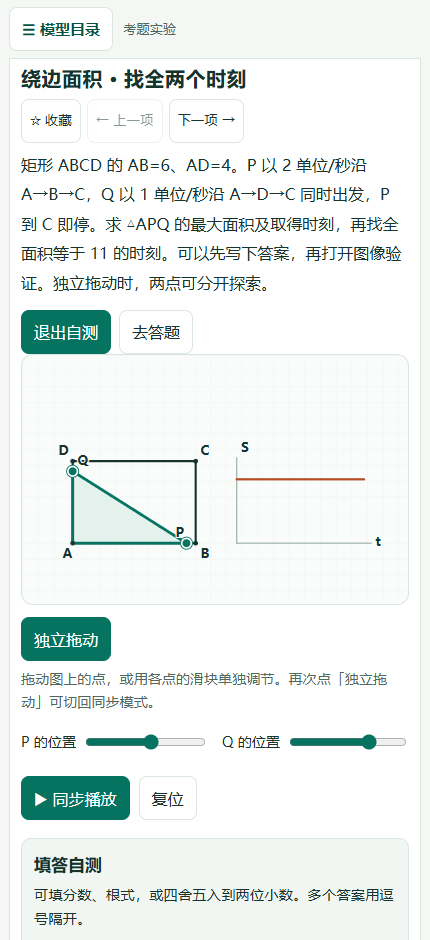

# 几何有迹 · JiHeYouJi

拖动点和射线，观察几何量怎样变化，再用题目检验自己的推导。几何有迹是一款面向七至九年级的离线动态数学练习工具。

[下载公开体验版](https://github.com/zhetao068-lgtm/jihe-youji/releases/latest) · [技术文章](articles/) · [隐私说明](PRIVACY.md) · [安全反馈](SECURITY.md)

## 从哪里开始

| 想练的考点 | 目录搜索 |
| --- | --- |
| 动点面积分段、多解、极值 | **绕边面积**。试着找同一个面积对应的两个时刻，再打开面积曲线验证。 |
| 角平分线、全等、相似和圆 | **角平分线**、**SAS**、**相似**、**切线**。 |
| 一次函数、反比例函数、二次函数的几何意义 | **斜率**、**双曲线**、**定周长矩形**。 |
| 空间图形 | **正方体展开图**。拖动进度模拟折回。 |

体验版包含 **14 个互动模型、1 道压轴题和 1 道考题实验**，其中 2 项提供自测。手机上点「模型目录」按考点搜索。考题实验里可以在同一时间轴播放，也可以切换到独立拖动模式，让 P、Q 分开移动。

## 下载和运行

- **Windows x64**。完整解压 ZIP，打开 `JiHeYouJi.exe`。需要 Microsoft Edge WebView2 Runtime。程序目前无商业代码签名，系统可能提示未知发布者，可先对照下载页的 SHA-256。
- **Android 8.0 及以上**。下载 APK。该版本为测试包，已核验签名和权限，真机兼容性待验证。如果设备或学校禁用旁加载，请遵循设备管理设置。

体验版无需注册或联网做题。收藏、答题草稿和进度留在当前应用中，可从页面底部的「本机学习记录」清除。仓库公开提供体验版和技术文章，安装包的学习内容与程序权利保留。

## 技术文章

1. [从绕矩形到分段函数：找全同面积的两个时刻](articles/01-piecewise-area.md)
2. [离线数学应用如何限制网页层的访问权限](articles/02-offline-webview.md)

## English

**JiHeYouJi** is an offline interactive study tool for junior-high geometry and function graphs. The bilingual landing page links to 16 Chinese-language interactive activities covering moving points, angles, triangles, circles, solids, and graphs. It has searchable topics, local progress, and independent controls for points P and Q in selected activities. Download the Windows x64 package or the preview Android APK from [GitHub Releases](https://github.com/zhetao068-lgtm/jihe-youji/releases). Engineering notes cover piecewise geometry and offline WebView isolation.
